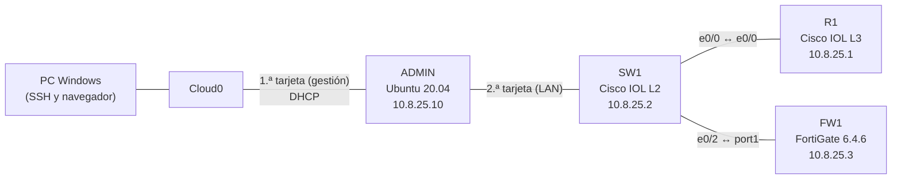
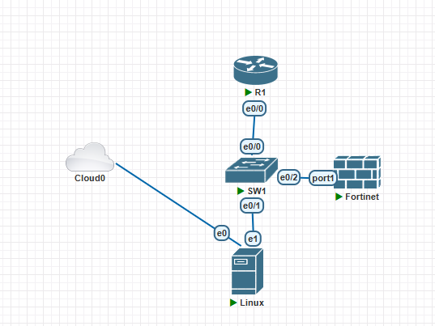
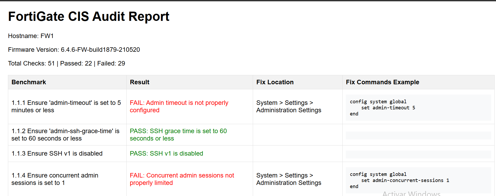
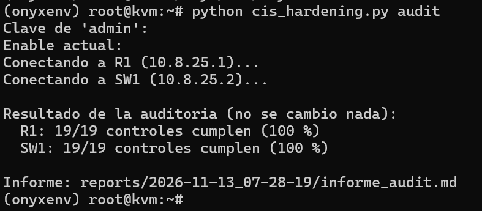
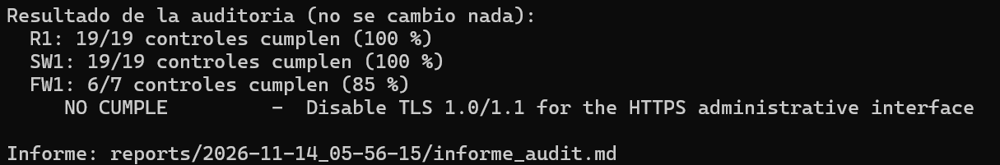
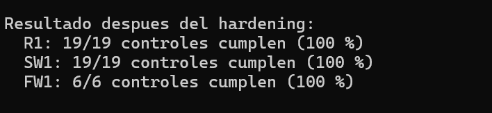
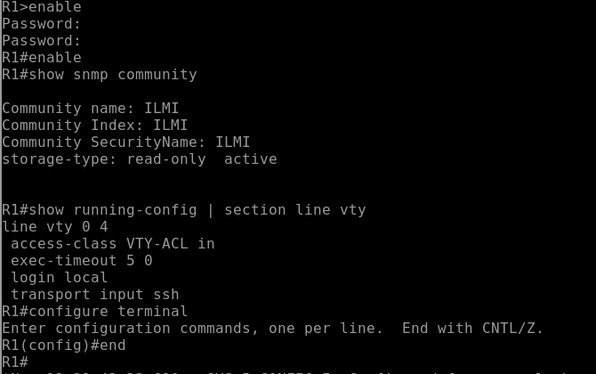
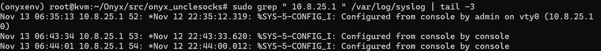
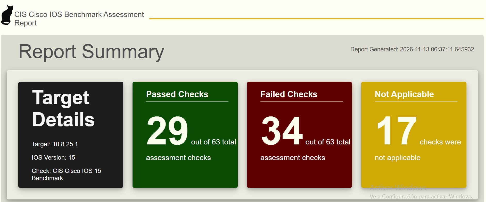
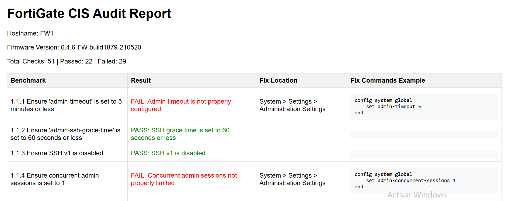

# Hardening CIS de un router, un switch y un firewall con auditoría automatizada

**Estudiante:** Aaron Hernandez | **Matrícula:** 2025-0800 | **Institución:** ITLA
**Asignatura:** Seguridad de Redes

## Video demostrativo

 https://youtu.be/bYGYQ-NPheA

> Duración: menos de 10 minutos, con fecha, hora, rostro y voz.

---

## Propósito del laboratorio

Tomar un router, un switch y un firewall con una configuración débil a propósito, auditarlos contra el CIS Benchmark, aplicar parte de las recomendaciones y comprobar con pruebas que la superficie de ataque bajó.

- **R1 (router) y SW1 (switch), Cisco IOS:** CIS Cisco IOS 15 Benchmark v4.1.1.
- **FW1 (firewall), FortiGate:** CIS FortiGate Benchmark.

Lo que se hizo:

- Auditoría del "antes" de R1 con **ONYX**, una herramienta de código abierto que revisa routers Cisco IOS contra el CIS.
- Auditoría del firewall con **Fortigate_CIS_check**, un verificador CIS de código abierto para FortiGate.
- Un script propio en Python (`cis_hardening.py`) que audita R1, SW1 y FW1 sin tocar nada (`audit`) o aplica los controles elegidos y genera un informe posterior (`harden`).
- Documentación de cada control aplicado y de por qué se aplicó.
- Pruebas del antes y el después, y una segunda auditoría con las herramientas CIS.

---

## Topología





### Conexiones

| Nodo A | Puerto | Nodo B | Puerto |
|---|---|---|---|
| R1 | e0/0 | SW1 | e0/0 |
| SW1 | e0/1 | ADMIN | 2.ª tarjeta (LAN) |
| SW1 | e0/2 | FW1 | port1 |
| ADMIN | 1.ª tarjeta | Cloud0 | n/a |

La tarjeta de Cloud0 solo sirve para instalar paquetes y entrar por SSH desde Windows. Toda la administración de R1, SW1 y FW1 pasa por la LAN.

### Direccionamiento

Red base `10.8.25.0/24`, derivada de la matrícula 2025-0800.

| Equipo | Interfaz | IP | Asignación |
|---|---|---|---|
| R1 | Ethernet0/0 | 10.8.25.1/24 | Fija |
| SW1 | VLAN 1 | 10.8.25.2/24 | Fija (gateway 10.8.25.1) |
| FW1 | port1 | 10.8.25.3/24 | Fija |
| ADMIN | LAN | 10.8.25.10/24 | Fija |
| ADMIN | Cloud0 | 192.168.152.129/24 | DHCP (solo gestión) |

### Equipos

| Equipo | Imagen |
|---|---|
| R1 | Cisco IOL L3 |
| SW1 | Cisco IOL L2 |
| FW1 | FortiGate-VM64-KVM v6.4.6 |
| ADMIN | Ubuntu Server 20.04, 2 tarjetas de red |

ADMIN es la estación desde la que se audita, se aplica el hardening y se reciben los logs de los equipos (rsyslog, UDP 514).

---

## Configuración inicial (débil a propósito)

Se dejó SSH funcionando para que el script pudiera entrar, y lo demás abierto para tener algo que endurecer: Telnet, HTTP, `enable password`, comunidades SNMP por defecto y líneas vty sin límites. En el firewall se dejaron abiertos HTTP y Telnet en la interfaz de administración y un tiempo de sesión de 60 minutos.

<details>
<summary>R1</summary>

```
enable
configure terminal
hostname R1
no ip domain-lookup
ip domain name lab.local
enable password ......
username admin privilege 15 secret Lab-2025x
interface Ethernet0/0
 ip address 10.8.25.1 255.255.255.0
 no shutdown
exit
ip http server
snmp-server community public RO
snmp-server community private RW
line con 0
 exec-timeout 0 0
 logging synchronous
line vty 0 4
 login local
 transport input all
 exec-timeout 0 0
exit
ip ssh version 2
crypto key generate rsa modulus 2048
end
write memory
```
</details>

<details>
<summary>SW1</summary>

```
enable
configure terminal
hostname SW1
no ip domain-lookup
ip domain name lab.local
enable password .....
username admin privilege 15 secret Lab-2025x
interface Vlan1
 ip address 10.8.25.2 255.255.255.0
 no shutdown
exit
ip default-gateway 10.8.25.1
ip http server
snmp-server community public RO
line con 0
 exec-timeout 0 0
 logging synchronous
line vty 0 4
 login local
 transport input all
 exec-timeout 0 0
exit
ip ssh version 2
crypto key generate rsa modulus 2048
end
write memory
```
</details>

<details>
<summary>FW1 (FortiGate)</summary>

El usuario `admin` se creó con la clave `Lab-2025x` en el primer inicio de sesión. Después:

```
config system global
    set hostname FW1
    set admintimeout 60
    set admin-https-ssl-versions tlsv1-1 tlsv1-2 tlsv1-3
end
config system interface
    edit port1
        set mode static
        set ip 10.8.25.3 255.255.255.0
        set allowaccess ping https ssh http telnet
    next
end
```
</details>

---

## Entorno de ADMIN

ONYX necesita Python 3.10 o superior (usa la instrucción `match`), y Ubuntu 20.04 trae Python 3.8. Se creó un entorno con Python 3.11 usando `uv`:

```bash
curl -LsSf https://astral.sh/uv/install.sh | sh
export PATH="$HOME/.local/bin:$PATH"
uv venv --python 3.11 ~/onyxenv
. ~/onyxenv/bin/activate
git clone https://github.com/UncleSocks/Onyx.git ~/Onyx
uv pip install -r ~/Onyx/requirements.txt "textfsm<2.0.0" "paramiko==3.5.1" "netmiko==4.4.0"
```

Se fijó `paramiko==3.5.1` porque las versiones más nuevas rechazan los algoritmos SSH antiguos que usan los equipos IOL (`no acceptable kex algorithm`).

Verificador CIS del firewall:

```bash
git clone https://github.com/Coldfirex/Fortigate_CIS_check.git ~/Fortigate_CIS_check
uv pip install tqdm
```

Receptor de logs en ADMIN:

```bash
sudo apt install -y rsyslog
sudo sed -i 's/^#module(load="imudp")/module(load="imudp")/; s/^#input(type="imudp" port="514")/input(type="imudp" port="514")/' /etc/rsyslog.conf
sudo systemctl restart rsyslog
```

---

## Auditoría inicial con ONYX (R1)

ONYX lee los equipos desde un `target.json` (en el repositorio se sube con las claves enmascaradas, ver [`onyx/target.json`](onyx/target.json)):

```bash
cd ~/Onyx/src/onyx_unclesocks
python onyx.py -v 15 -o onyx_antes_R1.html
```

Resultado sobre R1: **11 aprobados, 52 fallidos y 17 no aplicables**, de 63 controles evaluables.


Reporte completo: [`onyx/onyx_antes_R1.html`](onyx/onyx_antes_R1.html)

---

## Auditoría del firewall con Fortigate_CIS_check

El verificador lee la configuración del firewall (`FW1_antes.conf` y `FW1_despues.conf`, que guarda el script) y genera un reporte con cada control. Se ejecuta desde la carpeta donde está su `checks.json`:

```bash
cd $(dirname $(find ~/Fortigate_CIS_check -name checks.json | head -1))
python fortigate_cis_checker.py ~/fw1_antes
python fortigate_cis_checker.py ~/fw1_despues
```



Resultado: **51 controles, 22 aprobados y 29 fallidos**, tanto antes como después del hardening.

Reportes: [`fw-checker/fw1_checker_antes.html`](fw-checker/fw1_checker_antes.html) y [`fw-checker/fw1_checker_despues.html`](fw-checker/fw1_checker_despues.html)

### Por qué el verificador no refleja los cambios

El hardening sí cambió el firewall (ver la tabla de cambios más abajo), pero el verificador da el mismo resultado antes y después. Está hecho para FortiOS 7.0.x y el firewall del laboratorio es FortiOS 6.4.6, así que:

- Busca `admin-timeout` y `trustedhost`, mientras FortiOS 6.4.6 escribe `admintimeout` y `trusthost1`.
- Para el control "acceso administrativo solo por HTTPS" exige `allowaccess https` a secas. Se conservó SSH a propósito, porque es la vía de administración desde ADMIN.
- El control de TLS sigue en FAIL porque FortiOS 6.4.6 rechazó el comando de endurecimiento.

Por eso la evidencia de los cambios en el firewall es la comparación de su configuración, el informe del script y las pruebas en consola.

---

## Script de hardening

El script está en [`scripts/cis_hardening.py`](scripts/cis_hardening.py). Se conecta por SSH con Netmiko y trabaja sobre la configuración de cada equipo: `show running-config` en los Cisco y `show full-configuration` en el FortiGate.

| Modo | Qué hace |
|---|---|
| `audit` | Revisa R1, SW1 y FW1 y genera un informe. **No cambia nada.** |
| `harden` | Muestra qué va a cambiar y pide escribir `SI`. Pide un `enable secret` nuevo para los equipos Cisco, aplica los controles que no cumplen, guarda la configuración, vuelve a auditar y genera el informe final con las columnas Antes / Después / Por qué. |

```bash
. ~/onyxenv/bin/activate
python cis_hardening.py audit
python cis_hardening.py harden
```

Opciones útiles: `--offline R1=archivo.txt FW1=archivo.conf` audita configuraciones guardadas sin conectarse (solo con `audit`), `--devices`, `--admin-ip` y `--syslog` cambian las IP del laboratorio, y `--skip ID` omite un control.

Por cada ejecución se crea `reports/<fecha>/` con el informe y las configuraciones de cada equipo antes y después. Si un equipo rechaza un comando, ese control sale como **N/A** y no cuenta para el porcentaje.





### Resultado del script

| Equipo | Antes | Después |
|---|---|---|
| R1 | 0/19 (0 %) | 19/19 (100 %) |
| SW1 | 2/19 (10 %) | 19/19 (100 %) |
| FW1 | 0/7 (0 %) | 6/6 (100 %), 1 control N/A |



- Auditoría inicial de los tres equipos: [`reports/2026-11-14_04-46-11/informe_audit.md`](reports/2026-11-14_04-46-11/informe_audit.md)
- Hardening aplicado a los tres equipos: [`reports/2026-11-14_05-02-16/informe_harden.md`](reports/2026-11-14_05-02-16/informe_harden.md)

<details>
<summary>Corridas anteriores (solo R1 y SW1, antes de agregar el firewall)</summary>

Antes de agregar el firewall se hizo una primera corrida con R1 y SW1. Después se volvió a dejar los equipos débiles para repetir todo con los tres.

- Auditoría inicial: [`reports/2026-11-13_06-31-58/informe_audit.md`](reports/2026-11-13_06-31-58/informe_audit.md)
- Hardening aplicado: [`reports/2026-11-13_06-32-49/informe_harden.md`](reports/2026-11-13_06-32-49/informe_harden.md)
- Auditoría posterior al hardening (solo lectura): [`reports/2026-11-13_07-28-19/informe_audit.md`](reports/2026-11-13_07-28-19/informe_audit.md). Confirma que los 19 controles siguen cumpliendo en R1 y en SW1.
- Segunda ejecución de `harden` (`reports/2026-11-13_07-30-40/informe_harden.md`): comprueba que el script es *idempotente*. Como todos los controles ya cumplían, no aplicó ningún comando y el antes y el después coinciden.

En las carpetas `07-28-19` y `07-30-40`, el archivo `*_antes.txt` ya es el estado endurecido, porque el script lo guarda al empezar cada ejecución.
</details>

---

## Controles CIS aplicados y por qué

### R1 y SW1 (CIS Cisco IOS 15 Benchmark v4.1.1)

Los IDs corresponden al benchmark, tal como los reporta ONYX.

| ID CIS | Control | Por qué se aplicó |
|---|---|---|
| 1.2.2 | `transport input ssh` en las líneas vty | Telnet envía usuario y clave en texto plano; SSH cifra la sesión |
| 1.2.4 | ACL `VTY-ACL` para las líneas vty | Define quién puede administrar el equipo: solo ADMIN (10.8.25.10) |
| 1.2.5 | `access-class VTY-ACL in` en las líneas vty | Sin él, cualquier host de la red puede intentar entrar |
| *ID no verificado* | `exec-timeout` de 5 minutos en consola y vty | Cierra sesiones abandonadas |
| 1.3.1, 1.3.2, 1.3.3 | Banners `exec`, `login` y `motd` | Aviso de acceso restringido, con respaldo ante accesos no autorizados |
| 1.4.1 | `enable secret` (y se elimina `enable password`) | El secret guarda un hash; el password queda legible |
| 1.4.2 | `service password-encryption` | Cifra las claves en la configuración |
| 1.5.2, 1.5.3 | Quitar las comunidades `private` y `public` | Son valores por defecto conocidos por cualquier atacante |
| 1.5.4 | Ninguna comunidad SNMP con permiso RW | Una comunidad de escritura permite modificar el equipo |
| 2.1.1.1.4 | `ip ssh time-out 60` | Limita el tiempo para autenticarse por SSH |
| 2.1.2 | `no cdp run` | CDP revela modelo, versión e IP a cualquier vecino |
| 2.1.3 | `no ip bootp server` | Servicio innecesario |
| 2.1.4 | `no service dhcp` | Los equipos no son servidores DHCP en esta topología |
| 2.1.8 | `no service pad` | Servicio heredado sin uso |
| 2.2.4 | `logging host 10.8.25.10` | Los logs quedan en ADMIN, fuera del equipo |
| *ID no verificado* | `no ip http server` | El servidor HTTP va en claro y amplía la superficie de ataque |

Dos controles no tienen ID porque ONYX no los lista y no se pudo confirmar el número en el PDF del benchmark.

### FW1 (CIS FortiGate Benchmark)

La columna "ID en el verificador" es el control equivalente en Fortigate_CIS_check.

| Control | ID en el verificador | Por qué se aplicó | Resultado |
|---|---|---|---|
| Quitar HTTP y Telnet de las interfaces (`allowaccess`) | 2.2.2 | HTTP y Telnet administran el firewall en texto plano; solo HTTPS y SSH cifran la sesión | Aplicado: `port1: ping https ssh` |
| `admintimeout` de 5 minutos | 1.1.1 | Cierra sesiones de administración abandonadas | Aplicado |
| Política de contraseñas | 1.2.2 y 2.3.11 | Evita claves de administrador débiles | Aplicado (`status enable`) |
| `trusthost1` del administrador | 1.2.1 | Solo ADMIN (10.8.25.10) puede iniciar sesión como administrador | Aplicado |
| Logs remotos (`syslogd`) | 2.3.26 | Los logs quedan en ADMIN, fuera del equipo | Aplicado |
| Desactivar la instalación automática por USB | 2.3.9 | Evita cargar configuración o firmware desde un USB con acceso físico | Aplicado |
| Quitar TLS 1.0/1.1 en la administración HTTPS | 2.1.10 | Las versiones TLS antiguas tienen debilidades conocidas | **N/A**: FortiOS 6.4.6 rechazó el comando |
---

## Cambios en la configuración del firewall

Comparación de `FW1_antes.conf` y `FW1_despues.conf` (las líneas que cambiaron):

```diff
-    set admintimeout 60
+    set admintimeout 5
-        set allowaccess ping https ssh http telnet
+        set allowaccess ping https ssh
-        set trusthost1 0.0.0.0 0.0.0.0
+        set trusthost1 10.8.25.10 255.255.255.255
```


## Pruebas: antes y después

| Prueba | Antes | Después |
|---|---|---|
| Telnet (puerto 23) en R1, SW1 y FW1 | Abierto | Rechazado (`Connection refused`) |
| HTTP a R1 y FW1 | Responde | Sin respuesta (código `000`) |
| `show cdp neighbors` en R1 | Muestra a SW1 | `% CDP is not enabled` |
| SNMP en R1 | `public` (RO) y `private` (RW) | Solo `ILMI`, una comunidad interna de solo lectura que crea IOS |
| Líneas vty | `transport input all`, sin timeout | `transport input ssh`, `access-class VTY-ACL in`, `exec-timeout 5 0` |
| Banners en R1 y SW1 | Ninguno | Visibles al entrar por SSH |
| Acceso de administración en FW1 | `ping https ssh http telnet` | `ping https ssh` |
| Administrador de FW1 | Desde cualquier IP, sesión de 60 min | `trusthost1 10.8.25.10`, sesión de 5 min |
| Logs | Sin servidor remoto | ADMIN recibe los eventos de R1 y SW1, y FW1 envía a 10.8.25.10 |
| ONYX sobre R1 | 11 aprobados / 52 fallidos | 29 aprobados / 34 fallidos |

Comandos usados desde ADMIN:

```bash
nc -zv -w3 10.8.25.1 23
nc -zv -w3 10.8.25.3 23
curl -s -m 4 -o /dev/null -w "%{http_code}\n" http://10.8.25.1
curl -s -m 4 -o /dev/null -w "%{http_code}\n" http://10.8.25.3
ssh -o KexAlgorithms=+diffie-hellman-group14-sha1 -o HostKeyAlgorithms=+ssh-rsa admin@10.8.25.1
sudo grep " 10.8.25.1 " /var/log/syslog | tail -3
```

Comandos dentro de R1:

```
show cdp neighbors
show snmp community
show access-lists
show running-config | section line vty
show running-config | section banner
```

Comandos dentro de FW1:

```
show system interface port1
show system admin admin
show log syslogd setting
get system status
```







### Auditoría final con las herramientas CIS



Reporte completo de ONYX: [`onyx/onyx_despues_R1.html`](onyx/onyx_despues_R1.html)



Reporte completo del verificador (mismo resultado que el "antes", por las diferencias de versión explicadas arriba): [`fw-checker/fw1_checker_despues.html`](fw-checker/fw1_checker_despues.html)

Reporte completo del verificador del firewall: [`fw-checker/fw1_checker_despues.html`](fw-checker/fw1_checker_despues.html)

---

## Running-configs

Corrida final con los tres equipos:

| Equipo | Antes | Después |
|---|---|---|
| R1 | [`R1_antes.txt`](reports/2026-11-14_05-02-16/running-configs/R1_antes.txt) | [`R1_despues.txt`](reports/2026-11-14_05-02-16/running-configs/R1_despues.txt) |
| SW1 | [`SW1_antes.txt`](reports/2026-11-14_05-02-16/running-configs/SW1_antes.txt) | [`SW1_despues.txt`](reports/2026-11-14_05-02-16/running-configs/SW1_despues.txt) |
| FW1 | [`FW1_antes.conf`](reports/2026-11-14_05-02-16/running-configs/FW1_antes.conf) | [`FW1_despues.conf`](reports/2026-11-14_05-02-16/running-configs/FW1_despues.conf) |

Las configuraciones de las corridas anteriores (solo R1 y SW1) están en las carpetas `reports/2026-11-13_*`.

---

## Notas y límites

- **El script cubre 19 controles en los equipos Cisco y 7 en el firewall, no todo el benchmark.** ONYX evalúa 63 controles de R1, y los 34 que siguen fallando después del hardening son recomendaciones que no se aplicaron en este laboratorio, como AAA, NTP con autenticación, interfaz loopback y traps SNMP.
- **ONYX marca el control 1.2.5 como fallido** (`Access-Class: None`) aunque `access-class VTY-ACL in` aparece en la configuración de las líneas vty (captura 09) y la ACL cuenta aciertos. Se interpreta como una limitación de cómo ONYX lee esa línea.
- **Control de TLS en el firewall:** FortiOS 6.4.6 rechazó el comando que quita TLS 1.0/1.1 de la administración HTTPS, así que el script lo marca como N/A. La configuración final sigue con `tlsv1-1 tlsv1-2` y no se presenta como cumplida.
- **Versión del firewall:** el verificador y el benchmark usados están pensados para FortiOS 7.0.x, y el laboratorio usa FortiOS 6.4.6 (licencia de evaluación). Por las diferencias de nombres de configuración, el verificador da el mismo resultado antes y después (ver la sección de auditoría del firewall).
- **Después del hardening, solo ADMIN puede administrar los equipos por SSH.** La consola de PNETLab sigue disponible como vía de recuperación.
- **Las claves son de laboratorio** y no se usan en ningún otro lugar. En `onyx/target.json` están enmascaradas. Las configuraciones guardadas contienen los hashes de esas claves.
- Los equipos son imágenes virtuales en PNETLab.

---

## Estructura del repositorio

```
.
├── README.md
├── img/
│   ├── 01-topologia.png
│   ├── 03-onyx-antes.png
│   ├── 04-audit-script.png
│   ├── 05-harden-script.png
│   ├── 06-informe-harden.png
│   ├── 07-onyx-despues.png
│   ├── 08-pruebas-despues.png
│   ├── 09-r1-verificacion.png
│   ├── 10-syslog-admin.png
│   ├── 11-fw1-verificador-antes.png
│   ├── 12-fw1-verificador-despues.png
│   └── 13-fw1-pruebas-despues.png
├── scripts/
│   └── cis_hardening.py
├── onyx/
│   ├── onyx_antes_R1.html
│   ├── onyx_despues_R1.html
│   └── target.json
├── fw-checker/
│   ├── fw1_checker_antes.html
│   └── fw1_checker_despues.html
└── reports/
    ├── 2026-11-13_06-31-58/
    ├── 2026-11-13_06-32-49/
    ├── 2026-11-13_07-28-19/
    ├── 2026-11-13_07-30-40/
    ├── 2026-11-14_04-46-11/
    │   ├── informe_audit.md
    │   └── running-configs/
    └── 2026-11-14_05-02-16/
        ├── informe_harden.md
        └── running-configs/
```