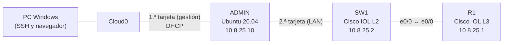
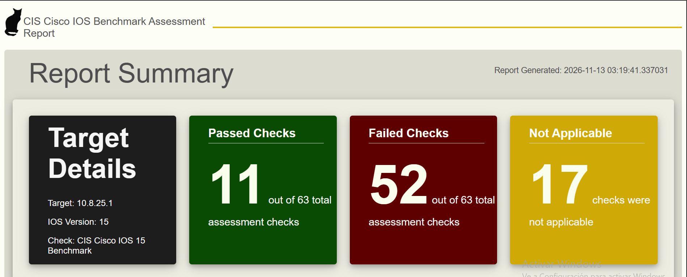
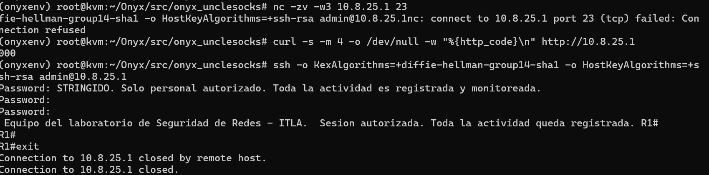

# Hardening CIS de un router y un switch Cisco con auditoría automatizada

**Estudiante:** Aaron Hernandez | **Matrícula:** 2025-0800 | **Institución:** ITLA
**Asignatura:** Seguridad de Redes

## Video demostrativo

> **[▶ Ver el video en YouTube](PEGAR_AQUI_EL_ENLACE_DEL_VIDEO)**
> Duración: menos de 10 minutos, con fecha, hora, rostro y voz.

---

## Propósito del laboratorio

Tomar un router y un switch Cisco con una configuración débil a propósito, auditarlos contra el **CIS Cisco IOS 15 Benchmark v4.1.1**, aplicar parte de las recomendaciones y comprobar con pruebas que la superficie de ataque bajó.

Lo que se hizo:

- Auditoría del "antes" con **ONYX**, una herramienta de código abierto que revisa routers Cisco IOS contra el CIS.
- Un script propio en Python (`cis_hardening.py`) que audita R1 y SW1 sin tocar nada (`audit`) o aplica los controles elegidos y genera un informe posterior (`harden`).
- Documentación de cada control aplicado y de por qué se aplicó.
- Pruebas del antes y el después, y una segunda auditoría con ONYX.

---

## Topología




### Conexiones

| Nodo A | Puerto | Nodo B | Puerto |
|---|---|---|---|
| R1 | e0/0 | SW1 | e0/0 |
| SW1 | e0/1 | ADMIN | 2.ª tarjeta (LAN) |
| ADMIN | 1.ª tarjeta | Cloud0 | n/a |

La tarjeta de Cloud0 solo sirve para instalar paquetes y entrar por SSH desde Windows. Toda la administración de R1 y SW1 pasa por la LAN.

### Direccionamiento

Red base `10.8.25.0/24`, derivada de la matrícula 2025-0800.

| Equipo | Interfaz | IP | Asignación |
|---|---|---|---|
| R1 | Ethernet0/0 | 10.8.25.1/24 | Fija |
| SW1 | VLAN 1 | 10.8.25.2/24 | Fija (gateway 10.8.25.1) |
| ADMIN | LAN | 10.8.25.10/24 | Fija |
| ADMIN | Cloud0 | 192.168.152.129/24 | DHCP (solo gestión) |

### Equipos

| Equipo | Imagen |
|---|---|
| R1 | Cisco IOL L3 |
| SW1 | Cisco IOL L2 |
| ADMIN | Ubuntu Server 20.04, 2 tarjetas de red |

ADMIN es la estación desde la que se audita, se aplica el hardening y se reciben los logs de los equipos (rsyslog, UDP 514).

---

## Configuración inicial (débil a propósito)

Se dejó SSH funcionando para que el script pudiera entrar, y lo demás abierto para tener algo que endurecer: Telnet, HTTP, `enable password`, comunidades SNMP por defecto y líneas vty sin límites.

<details>
<summary>R1</summary>

```
enable
configure terminal
hostname R1
no ip domain-lookup
ip domain name lab.local
enable password ......
username admin privilege 15 secret Lab-2025x
interface Ethernet0/0
 ip address 10.8.25.1 255.255.255.0
 no shutdown
exit
ip http server
snmp-server community public RO
snmp-server community private RW
line con 0
 exec-timeout 0 0
 logging synchronous
line vty 0 4
 login local
 transport input all
 exec-timeout 0 0
exit
ip ssh version 2
crypto key generate rsa modulus 2048
end
write memory
```
</details>

<details>
<summary>SW1</summary>

```
enable
configure terminal
hostname SW1
no ip domain-lookup
ip domain name lab.local
enable password .....
username admin privilege 15 secret Lab-2025x
interface Vlan1
 ip address 10.8.25.2 255.255.255.0
 no shutdown
exit
ip default-gateway 10.8.25.1
ip http server
snmp-server community public RO
line con 0
 exec-timeout 0 0
 logging synchronous
line vty 0 4
 login local
 transport input all
 exec-timeout 0 0
exit
ip ssh version 2
crypto key generate rsa modulus 2048
end
write memory
```
</details>

---

## Entorno de ADMIN

ONYX necesita Python 3.10 o superior (usa la instrucción `match`), y Ubuntu 20.04 trae Python 3.8. Se creó un entorno con Python 3.11 usando `uv`:

```bash
curl -LsSf https://astral.sh/uv/install.sh | sh
export PATH="$HOME/.local/bin:$PATH"
uv venv --python 3.11 ~/onyxenv
. ~/onyxenv/bin/activate
git clone https://github.com/UncleSocks/Onyx.git ~/Onyx
uv pip install -r ~/Onyx/requirements.txt "textfsm<2.0.0" "paramiko==3.5.1" "netmiko==4.4.0"
```

Se fijó `paramiko==3.5.1` porque las versiones más nuevas rechazan los algoritmos SSH antiguos que usan los equipos IOL (`no acceptable kex algorithm`).

Receptor de logs en ADMIN:

```bash
sudo apt install -y rsyslog
sudo sed -i 's/^#module(load="imudp")/module(load="imudp")/; s/^#input(type="imudp" port="514")/input(type="imudp" port="514")/' /etc/rsyslog.conf
sudo systemctl restart rsyslog
```

---

## Auditoría inicial con ONYX

ONYX lee los equipos desde un `target.json` (en el repositorio se sube con las claves enmascaradas, ver [`onyx/target.json`](onyx/target.json)):

```bash
cd ~/Onyx/src/onyx_unclesocks
python onyx.py -v 15 -o onyx_antes_R1.html
```

Resultado sobre R1: **11 aprobados, 52 fallidos y 17 no aplicables**, de 63 controles evaluables.



Reporte completo: [`onyx/onyx_antes_R1.html`](onyx/onyx_antes_R1.html)

---

## Script de hardening

El script está en [`scripts/cis_hardening.py`](scripts/cis_hardening.py). Se conecta por SSH con Netmiko y trabaja sobre la `running-config` de cada equipo.

| Modo | Qué hace |
|---|---|
| `audit` | Revisa R1 y SW1 y genera un informe. **No cambia nada.** |
| `harden` | Muestra qué va a cambiar y pide escribir `SI`. Pide un `enable secret` nuevo, aplica los controles que no cumplen, guarda la configuración, vuelve a auditar y genera el informe final con las columnas Antes / Después / Por qué. |

```bash
. ~/onyxenv/bin/activate
python cis_hardening.py audit
python cis_hardening.py harden
```

Opciones útiles: `--offline R1=archivo.txt SW1=archivo.txt` audita configuraciones guardadas sin conectarse (solo con `audit`), y `--devices`, `--admin-ip` y `--syslog` cambian las IP del laboratorio.

Por cada ejecución se crea `reports/<fecha>/` con el informe y las `running-config` de cada equipo antes y después.


### Resultado del script

| Equipo | Antes | Después |
|---|---|---|
| R1 | 0/19 (0 %) | 19/19 (100 %) |
| SW1 | 2/19 (10 %) | 19/19 (100 %) |


- Informe de auditoría: [`reports/2026-11-13_06-31-58/informe_audit.md`](reports/2026-11-13_06-31-58/informe_audit.md)
- Informe de hardening: [`reports/2026-11-13_06-32-49/informe_harden.md`](reports/2026-11-13_06-32-49/informe_harden.md)

---

## Controles CIS aplicados y por qué

Los IDs corresponden al CIS Cisco IOS 15 Benchmark v4.1.1, tal como los reporta ONYX.

| ID CIS | Control | Por qué se aplicó |
|---|---|---|
| 1.2.2 | `transport input ssh` en las líneas vty | Telnet envía usuario y clave en texto plano; SSH cifra la sesión |
| 1.2.4 | ACL `VTY-ACL` para las líneas vty | Define quién puede administrar el equipo: solo ADMIN (10.8.25.10) |
| 1.2.5 | `access-class VTY-ACL in` en las líneas vty | Sin él, cualquier host de la red puede intentar entrar |
| *ID no verificado* | `exec-timeout` de 5 minutos en consola y vty | Cierra sesiones abandonadas |
| 1.3.1, 1.3.2, 1.3.3 | Banners `exec`, `login` y `motd` | Aviso de acceso restringido, con respaldo ante accesos no autorizados |
| 1.4.1 | `enable secret` (y se elimina `enable password`) | El secret guarda un hash; el password queda legible |
| 1.4.2 | `service password-encryption` | Cifra las claves en la configuración |
| 1.5.2, 1.5.3 | Quitar las comunidades `private` y `public` | Son valores por defecto conocidos por cualquier atacante |
| 1.5.4 | Ninguna comunidad SNMP con permiso RW | Una comunidad de escritura permite modificar el equipo |
| 2.1.1.1.4 | `ip ssh time-out 60` | Limita el tiempo para autenticarse por SSH |
| 2.1.2 | `no cdp run` | CDP revela modelo, versión e IP a cualquier vecino |
| 2.1.3 | `no ip bootp server` | Servicio innecesario |
| 2.1.4 | `no service dhcp` | Los equipos no son servidores DHCP en esta topología |
| 2.1.8 | `no service pad` | Servicio heredado sin uso |
| 2.2.4 | `logging host 10.8.25.10` | Los logs quedan en ADMIN, fuera del equipo |
| *ID no verificado* | `no ip http server` | El servidor HTTP va en claro y amplía la superficie de ataque |

Dos controles no tienen ID porque ONYX no los lista y no se pudo confirmar el número en el PDF del benchmark.

---

## Pruebas: antes y después

| Prueba | Antes | Después |
|---|---|---|
| Telnet (puerto 23) | Abierto | Rechazado (`Connection refused`) |
| HTTP al router | Responde | Sin respuesta (código `000`) |
| `show cdp neighbors` | Muestra a SW1 | `% CDP is not enabled` |
| SNMP | `public` (RO) y `private` (RW) | Solo `ILMI`, una comunidad interna de solo lectura que crea IOS |
| Líneas vty | `transport input all`, sin timeout | `transport input ssh`, `access-class VTY-ACL in`, `exec-timeout 5 0` |
| Banners | Ninguno | Visibles al entrar por SSH |
| Logs | Sin servidor remoto | ADMIN recibe los eventos de R1 y SW1 |
| ONYX sobre R1 | 11 aprobados / 52 fallidos | 29 aprobados / 34 fallidos |

Comandos usados desde ADMIN:

```bash
nc -zv -w3 10.8.25.1 23
curl -s -m 4 -o /dev/null -w "%{http_code}\n" http://10.8.25.1
ssh -o KexAlgorithms=+diffie-hellman-group14-sha1 -o HostKeyAlgorithms=+ssh-rsa admin@10.8.25.1
sudo grep " 10.8.25.1 " /var/log/syslog | tail -3
```

Comandos dentro de R1:

```
show cdp neighbors
show snmp community
show access-lists
show running-config | section line vty
show running-config | section banner
```





### Auditoría final con ONYX


Reporte completo: [`onyx/onyx_despues_R1.html`](onyx/onyx_despues_R1.html)

---

## Running-configs

| Equipo | Antes | Después |
|---|---|---|
| R1 | [`R1_antes.txt`](reports/2026-11-13_06-32-49/running-configs/R1_antes.txt) | [`R1_despues.txt`](reports/2026-11-13_06-32-49/running-configs/R1_despues.txt) |
| SW1 | [`SW1_antes.txt`](reports/2026-11-13_06-32-49/running-configs/SW1_antes.txt) | [`SW1_despues.txt`](reports/2026-11-13_06-32-49/running-configs/SW1_despues.txt) |

---

## Notas y límites

- **El script cubre 19 controles, no todo el benchmark.** ONYX evalúa 63 controles, y los 34 que siguen fallando después del hardening son recomendaciones que no se aplicaron en este laboratorio, como AAA, NTP con autenticación, interfaz loopback y traps SNMP.
- **ONYX marca el control 1.2.5 como fallido** (`Access-Class: None`) aunque `access-class VTY-ACL in` aparece en la configuración de las líneas vty (captura 09) y la ACL cuenta aciertos. Se interpreta como una limitación de cómo ONYX lee esa línea.
- **Después del hardening, solo ADMIN puede entrar por SSH.** La consola de PNETLab sigue disponible como vía de recuperación.
- **Las claves son de laboratorio** y no se usan en ningún otro lugar. En `onyx/target.json` están enmascaradas. Las running-configs contienen los hashes de esas claves.
- Los equipos son imágenes virtuales Cisco IOL en PNETLab.

---

## Estructura del repositorio

```
.
├── README.md
├── img/
│   ├── 01-topologia.png
│   ├── 03-onyx-antes.png
│   ├── 04-audit-script.png
│   ├── 05-harden-script.png
│   ├── 06-informe-harden.png
│   ├── 07-onyx-despues.png
│   ├── 08-pruebas-despues.png
│   ├── 09-r1-verificacion.png
│   └── 10-syslog-admin.png
├── scripts/
│   └── cis_hardening.py
├── onyx/
│   ├── onyx_antes_R1.html
│   ├── onyx_despues_R1.html
│   └── target.json
└── reports/
    ├── 2026-11-13_06-31-58/
    │   ├── informe_audit.md
    │   └── running-configs/
    └── 2026-11-13_06-32-49/
        ├── informe_harden.md
        └── running-configs/
```